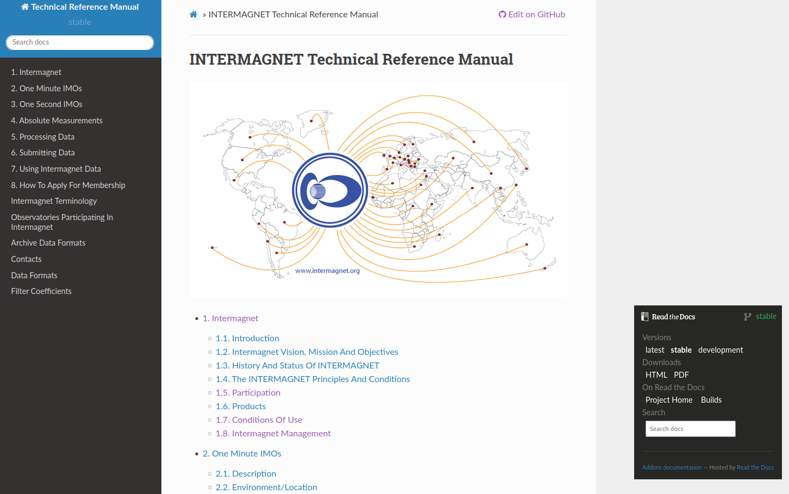

.. _use_dat_imag_web:

INTERMAGNET WEB Site
====================
.. include:: ../../shared/variables.rst
.. include:: ../../shared/targets.rst
.. include:: ../../appendices/appendices.rst


The INTERMAGNET web site provides background information about
INTERMAGNET, its structure, and participating
organizations, countries and IMOs (INTERMAGNET Magnetic
Observatories).

The web site offers access to various data products:

* The annual definitive data published with a
  Digital Object Identifier (DOI).
* Magnetograms and data files of preliminary
  minute values from all the IMOs.
* The Online Technical Reference Manual.
* The INTERMAGNET application form.

INTERMAGNET moved away from in-house maintained servers towards
free cloud-based services to deploy the web site.
The following underlying technologies were selected for the web site :

* a GitHub repository for all software, web site development and discussion forums : |intermagnet_github|
* The INTERMAGNET web site has been designed using GitHub Pages (|git_hub_pages|).
* The Online Technical Reference Manual is produced using the  `sphinx framework`_ making it possible to generate both pdf and html versions of the manual
  The manual is automatically built and deployed using the services offered by `readthedocs.org`_.

Geomagnetic metadata and data are hosted by the British Geological Survey (BGS). The annual definitive data are
deployed on the servers of the German Research Centre for Geosciences (GFZ). 


.. _use_dat_imag_web_addr:

WEB Site Address
----------------

The INTERMAGNET web site address is: |intermagnet_website|.
This gives access to the home page from where information about INTERMAGNET is available.
The source code for the website is available on the INTERMAGNET GitHub.


.. _use_dat_imag_web_online_tech_man:

Online Technical Reference Manual
---------------------------------

The Online Technical Reference manual can be found on the subdomain |techman_website|. It is possible to download the manual in different formats.



    Online Technical Reference manual

On the right side, you will find links to download the manual in PDF or HTML format.

There are three versions available:

#. stable : The latest official release (the most up to date version to be used as a reference).
#. latest : The current working version with accepted changes but not ready for an official release.
#. development : This version may contain errors and/or proposed changes not yet accepted.

The stable version should be the only one used as reference.


.. _use_dat_imag_web_down_data:

Downloading Data
----------------

Geomagnetic observatory data can be downloaded using a web browser:

- Definitive data and metadata can be downloaded from the INTERMAGNET DOIs.
- Definitive and provisional data can be viewed and downloade from the INTERMAGNET web site.

Until 2015, the annual definitive data was released on a physical media (see :numref:`use_dat_physical_media`).
From 2015 onward, the intermagnet definitive data is published yearly with a Digital Object Identifier (DOI) which includes
all definitive data from 1991 up to the publication year. 


.. _use_dat_imag_web_down_data_doi:

Downloading Data Using DOIs
```````````````````````````
Beginning with the publication of the definitive data for 2015, INTERMAGNET stopped
publishing individual years of data and started publishing the entire, cumulative
definitive data set since INTERMAGNET’s first recorded definitive data in 1991.

This DOI-referenced annual data set is known as the "INTERMAGNET Reference Data Set" (IRDS).
The IRDS comprises all INTERMAGNET one-minute definitive data since 1991 and is annually updated
with a new year and occasional corrections to previous releases.
The DOIs and their associated data are hosted at `GFZ data services`_.
Use the `GFZ DOI search`_ page and enter "Intermagnet" in the search box to show all INTERMAGNET 
definitive data DOIs.

A download section on the DOI landing page gives access to the data. 
The structure and format of the data are fully described in
|app_imag_dir| and |app_iaf|.


.. _use_dat_imag_web_down_data_web:

Downloading Data Using the WEB Interface
````````````````````````````````````````

Provisional INTERMAGNET data (including quasi-definitive) are available for many IMOs in near real-time.
The availability of data files is dependent on the
publishing delay and data embargo policy of participating institutes. If there is no
publishing delay, data may be available within a few minutes or even seconds
of being recorded. The data covers the period
from 1991 to present. In addition to preliminary data,
definitive data may also be available for one-minute 
or one-second sampling rates in various data formats. However the hourly means, daily means,
K indices and rich metadata the are available from the DOI downloads are not available through
the web interface.

Data are available
via web services. For further details and to download data, you can consult 
the INTERMAGNET web site: |download_plot_data|

Plots of magnetic observatory data and information derived from
the data are also available. These include:

-  Plots of X, Y, Z magnetic field components
-  Plots of H, D, Z magnetic field components
-  Plots of declination and inclination


.. _use_dat_imag_web_geo_act:

Geomagnetic Activity
--------------------

A tool for viewing Geomagnetic activity is available on the BGS web site.
As well as providing access to real-time data, it allows users to search 
both Intermagnet and the World Data Centre (Edinburgh) archives to 
facilitate comparison with historic data.

`BGS Activity viewer`_

